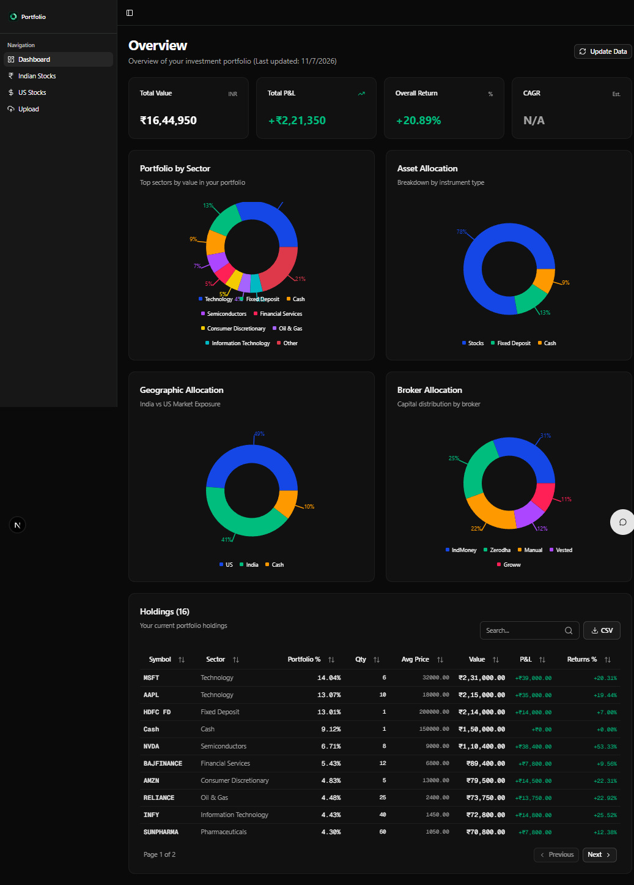
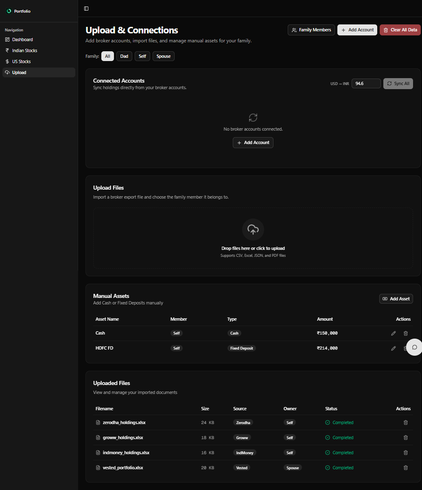
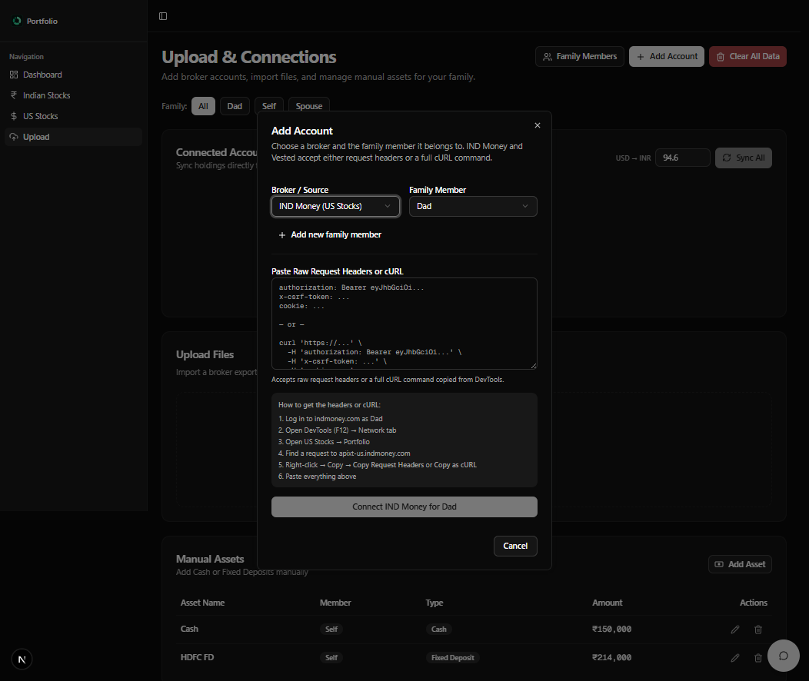
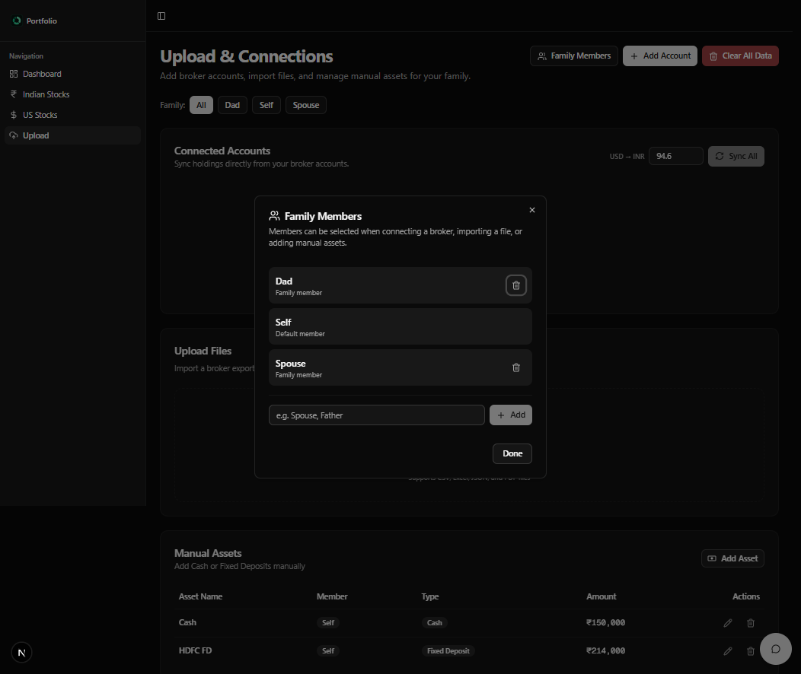

<p align="center">
  
</p>

<h1 align="center">Portfolio Dashboard</h1>

<p align="center">
  A local-first dashboard for tracking Indian and US investment portfolios across brokers.
</p>

<p align="center">
  <a href="LICENSE"></a>
  
  
  
</p>

Portfolio Dashboard pulls holdings from Indian and US brokers, merges them into a
single view, and keeps the data in your browser. It can connect to Zerodha,
Groww, IND Money, and Vested, or import the Excel exports those brokers provide.
It also includes a chat assistant that can answer questions about the portfolio.

> [!IMPORTANT]
> This is a local-only, unauthenticated app. Run it on a trusted machine and
> keep both servers bound to loopback. See [DISCLAIMER.md](DISCLAIMER.md) and
> [TERMS.md](TERMS.md) before using real accounts.

## Screenshots

| Dashboard | Upload & connections |
| --- | --- |
|  |  |

| Add account | Family members |
| --- | --- |
|  |  |

All screenshots use fake portfolio data.

## Features

- **Unified portfolio view** with total value, P&L, return, sector, asset,
  geography, and broker breakdowns.
- **Broker sync** for Zerodha, Groww, IND Money, and Vested.
- **Excel import** for broker exports, plus manual assets such as cash and fixed
  deposits.
- **Family members** so each broker account can belong to a different person.
- **Multiple accounts per broker**, with a consolidated connections table.
- **Local-first storage** in IndexedDB — portfolio data never leaves your machine
  unless you use the chat feature.
- **AI chat** through Google Gemini or a local Ollama model.
- **CSV export** of the merged holdings table.
- **Dark and light themes**.

## Tech stack

| Layer | Technology |
| --- | --- |
| Frontend | Next.js 16 (App Router), React 19, TypeScript |
| Styling | Tailwind CSS 4, shadcn/ui, Recharts |
| Local storage | Dexie (IndexedDB) |
| Backend | NestJS 12, TypeScript |
| Broker APIs | Kite Connect, Groww, IND Money, Vested |
| Market data | Yahoo Finance (`yahoo-finance2`) |
| Spreadsheets | SheetJS (`xlsx`) |
| Chat | Hashbrown, Google Gemini or Ollama |
| Tests | Jest, Cypress |

## Architecture

```text
Browser (Next.js, 127.0.0.1:3000)
  ├─ React UI, charts, chat widget
  ├─ IndexedDB (Dexie): portfolio items, uploaded files, family members
  └─ fetch ─────────────────────────────────────────────┐
                                                        │
NestJS API (127.0.0.1:3001)                             │
  ├─ /api/zerodha   Kite Connect OAuth + holdings       │
  ├─ /api/groww     API key/secret or TOTP + holdings   │
  ├─ /api/indmoney  pasted headers/cURL + holdings      │
  ├─ /api/vested    pasted headers/cURL + holdings      │
  └─ /api/chat      Gemini / Ollama streaming           │
                                                        │
Broker and market-data services ◄───────────────────────┘
```

Broker access tokens are kept in the NestJS process memory. Restarting the API
clears them, so reconnect your accounts after a restart.

## Getting started

### Prerequisites

- Node.js **20.9 or newer**
- npm (the repository includes a lockfile)
- Optional: a Google AI API key for chat, or a local Ollama install

### 1. Install dependencies

```bash
npm install
cd server
npm install
cd ..
```

### 2. Configure environment variables

Copy the example files and fill in the values you need:

```powershell
# Windows
copy .env.example .env.local
copy server\.env.example server\.env
```

```bash
# macOS / Linux
cp .env.example .env.local
cp server/.env.example server/.env
```

| File | Variable | Purpose |
| --- | --- | --- |
| `.env.local` | `NEXT_PUBLIC_API_URL` | Base URL of the NestJS API. Default: `http://127.0.0.1:3001`. |
| `server/.env` | `GOOGLE_API_KEY` | Gemini key for the chat endpoint. Optional if you use Ollama only. |
| `server/.env` | `ZERODHA_API_KEY` | Kite Connect API key. |
| `server/.env` | `ZERODHA_API_SECRET` | Kite Connect API secret. |
| `server/.env` | `ZERODHA_REDIRECT_URL` | Redirect URL registered with Kite Connect. Default: `http://127.0.0.1:3000/auth/zerodha-callback`. |

`.env.local` and `server/.env` are gitignored. Never commit real values.

### 3. Run the app

Open two terminals.

```bash
# Terminal 1 — frontend
npm run dev
```

```bash
# Terminal 2 — API
cd server
npm run start:dev
```

Open **http://127.0.0.1:3000**.

## Connecting accounts

Open **Upload → Connections → Add account**, then choose a broker and a family
member.

### Zerodha

1. Create an app at [developers.kite.trade](https://developers.kite.trade/).
2. Set the redirect URL to `http://127.0.0.1:3000/auth/zerodha-callback`.
3. Put the API key and secret in `server/.env`.
4. In the app, choose Zerodha and click **Connect**. You will be redirected to
   Kite, then back to the app.

### Groww

Choose Groww in the Add account dialog and authenticate with either:

- **API key + secret**, or
- a **6-digit TOTP** code.

The credentials are sent to the local API and are not stored in the browser.

### IND Money and Vested

These integrations accept the request headers or a full cURL command copied from
your browser's DevTools while logged in to the broker:

1. Open the broker website and log in.
2. Open DevTools → Network, find an authenticated API request, and copy it as
   cURL (or copy the request headers).
3. Paste the value into the Add account dialog.

The dialog understands `authorization`, `x-csrf-token`, and `cookie` headers,
including `-H`/`--header` flags and quoted or `$'...'` values.

> [!CAUTION]
> Pasted headers and cURL commands contain live session credentials. Do not
> share screenshots or logs that include them.

### Excel imports and manual assets

The Upload page also accepts broker Excel exports. Select the broker and family
member first, then upload the file. Use the manual asset dialog for cash, fixed
deposits, and other holdings that are not in a broker export.

## Data and privacy

- Portfolio items, uploaded file metadata, and family members live in
  **IndexedDB** in your browser profile.
- The API does not persist broker tokens to disk; they are kept in memory.
- The app has no analytics, telemetry, or remote database.
- The chat feature sends your prompt and the portfolio context you include to
  the selected provider (Gemini or Ollama).
- Clearing site data in the browser removes the local portfolio.

## Scripts

| Command | Description |
| --- | --- |
| `npm run dev` | Start the Next.js dev server on `127.0.0.1:3000`. |
| `npm run build` | Production build of the frontend. |
| `npm run start` | Start the production frontend on `127.0.0.1:3000`. |
| `npm run lint` | Lint the frontend and API source. |
| `npm run typecheck` | Type-check the frontend. |
| `npm test` | Run Jest unit tests. |
| `npm run test:e2e` | Run Cypress end-to-end tests headlessly. |
| `npm run test:e2e:open` | Open the Cypress runner. |
| `cd server && npm run start:dev` | Start the API in watch mode. |
| `cd server && npm run build` | Build the API. |
| `cd server && npm run start:prod` | Run the built API. |
| `node scripts/generate-fixtures.js` | Regenerate the Cypress spreadsheet fixtures. |

## Project structure

```text
src/
  app/                 Next.js routes (dashboard, upload, stocks, auth callback)
  components/          UI, charts, dialogs, chat widget
  lib/
    api/               Typed clients for each broker
    db.ts              Dexie schema
    excel-parser.ts    Broker spreadsheet parsers
    storage.ts         Portfolio read/write helpers
server/
  src/
    zerodha/           Kite Connect integration
    groww/             Groww integration
    indmoney/          IND Money integration
    vested/            Vested integration
    app.controller.ts  Chat streaming endpoints
scripts/               Maintenance scripts
cypress/               End-to-end tests and fixtures
docs/screenshots/      README screenshots
```

## Troubleshooting

**The dashboard says it cannot reach the API.**
Start the API from the `server` folder and confirm it is listening on
`127.0.0.1:3001`.

**A broker shows as disconnected after restarting the API.**
Tokens are in memory by design. Reconnect the account.

**The frontend opens on a different port.**
If port 3000 is busy, Next.js picks another port. Update the API CORS origins in
`server/src/main.ts` and the broker redirect URLs if you change ports.

**Zerodha login fails.**
Confirm `ZERODHA_REDIRECT_URL` exactly matches the redirect URL registered with
Kite Connect, including the port.

**Cypress cannot find the app.**
Start the frontend on `127.0.0.1:3000` before running the e2e tests.

## Security

This project is designed for local, single-user use. Before exposing it to a
network:

- add authentication to the API;
- serve both apps over HTTPS;
- replace in-memory tokens with encrypted, per-user storage;
- review the CORS and redirect configuration.

To report a vulnerability, follow [SECURITY.md](SECURITY.md). Never include real
credentials or portfolio data in an issue.

## Contributing

See [CONTRIBUTING.md](CONTRIBUTING.md) and [CODE_OF_CONDUCT.md](CODE_OF_CONDUCT.md).

## License

[MIT](LICENSE) © Monis Bana

## Disclaimer

This project is not affiliated with any broker or data provider, is not
financial advice, and uses some unofficial broker endpoints. Read
[DISCLAIMER.md](DISCLAIMER.md) and [TERMS.md](TERMS.md) before connecting a real
account.
